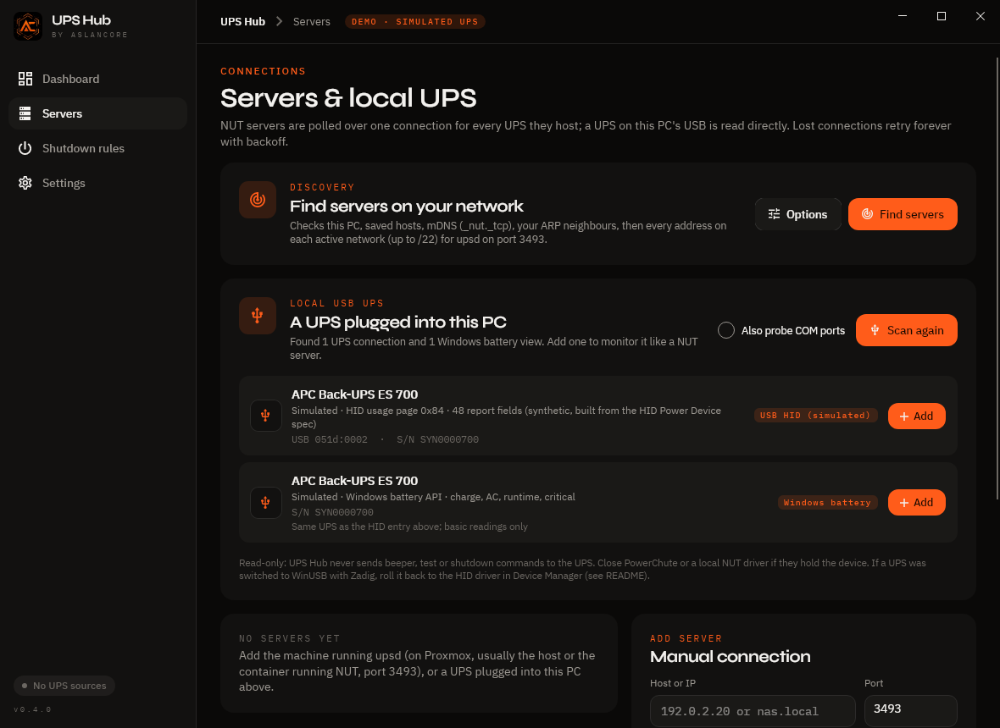
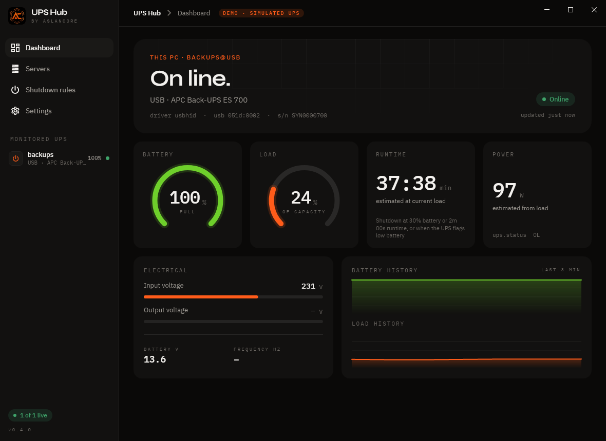
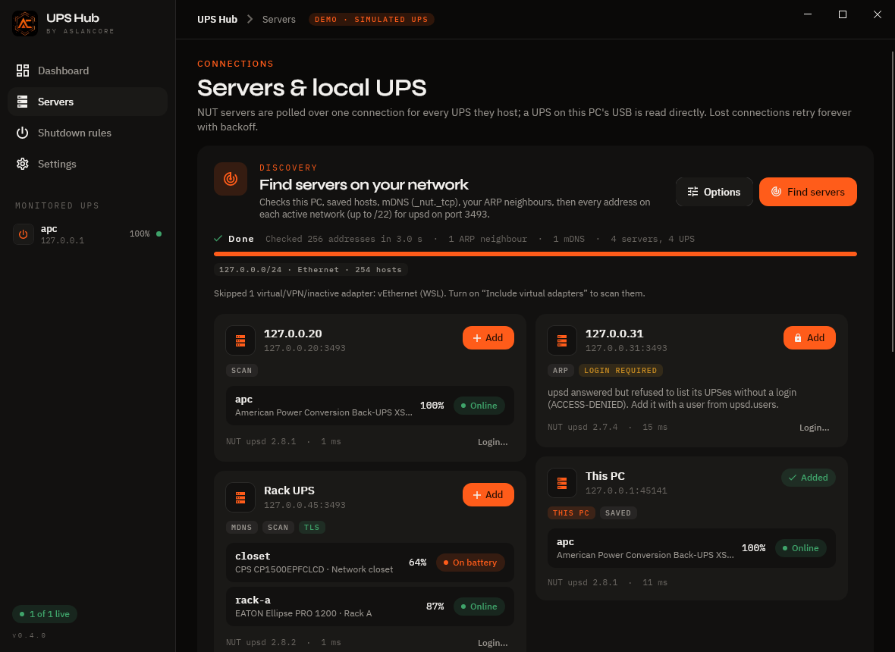
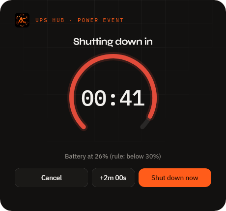
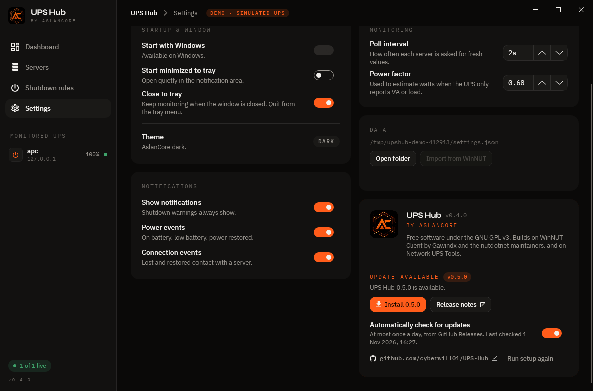
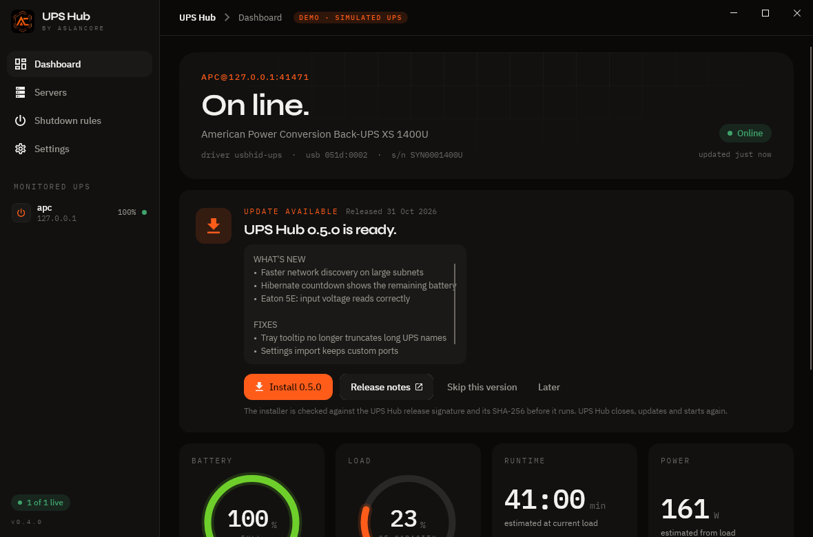
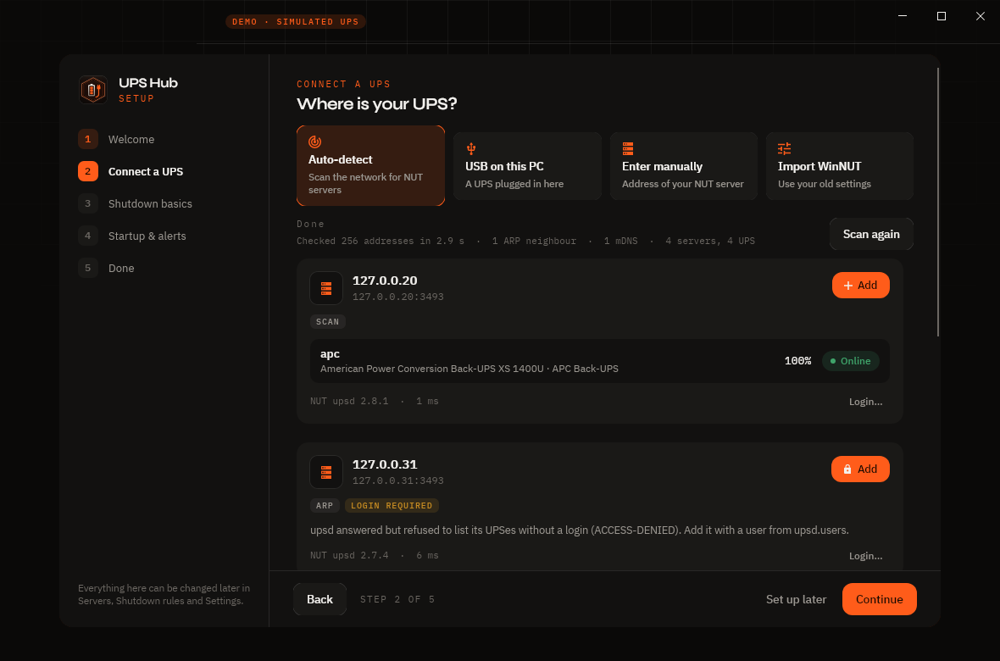
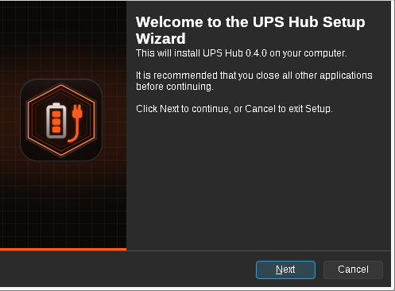

# UPS Hub

**by AslanCore.** A modern, native Windows client for [Network UPS Tools](https://networkupstools.org/) (NUT).
It watches one or more UPSes on your network, or a UPS plugged straight into this PC by USB, and shuts your PC down cleanly before the battery runs out.

UPS Hub is a ground-up rewrite inspired by [WinNUT-Client](https://github.com/gawindx/WinNUT-Client), which is no longer maintained.
It is written in C# on .NET 10 and uses the [Avalonia](https://avaloniaui.net) UI framework. It is not a web app: no browser engine, no WebView, no Electron.


## Install

Download `UpsHub-Setup-0.4.0.exe` (installer) or `UpsHub-0.4.0-win-x64.zip` (portable) from [GitHub Releases](https://github.com/cyberwill01/UPS-Hub/releases). The app needs Windows 10 or 11, x64.

- The installer is per-user and asks for no admin rights. It installs to `%LOCALAPPDATA%\Programs\UPS Hub`.
- The portable zip needs no install: unzip it and run `UpsHub.exe`.
- **The binaries are not code-signed yet.** Windows SmartScreen may say "Windows protected your PC". Choose *More info → Run anyway* if the checksum matches.
- To verify a download:
  ```powershell
  Get-FileHash .\UpsHub-Setup-0.4.0.exe -Algorithm SHA256
  ```
  Compare the result with `SHA256SUMS.txt` from the release. `SHA256SUMS.txt.minisig` signs that file and can be checked with `minisign -Vm SHA256SUMS.txt -P RWTkuntIbxaEgIdipWngZd/lNqKd4Bvp2H+uqxGQy6/fA2sgF+XcJxZ7`.

> **Direct USB mode is EXPERIMENTAL.** Reading a UPS plugged into this PC by USB, without NUT, has only been tested against synthetic HID fixtures, not real hardware. Please [open an issue](https://github.com/cyberwill01/UPS-Hub/issues) with your UPS model and what worked or didn't. Monitoring through a NUT server is the tested path.

## Status

**Phase 1 (0.1.0):**
- NUT client over TCP 3493:
  - `VER`, `LIST UPS`, `LIST VAR`, `GET VAR`.
  - Optional `USERNAME`/`PASSWORD` and `LOGIN` (registers as an upsmon secondary).
  - Optional `STARTTLS` (Off / Prefer / Require).
  - Friendly messages for NUT error codes.
- Multiple servers, and every UPS on each server. One connection per server.
- Perpetual reconnect with backoff. Quiet reconnect after sleep/resume.
- Stale data is shown as unknown and never triggers a shutdown.
- Shutdown rules:
  - Battery % threshold, runtime threshold, and/or the UPS low-battery flag. Forced shutdown (FSD) from the server is followed by default. Optionally, it can also act when the connection is lost while on battery.
  - On-battery delay.
  - A cancellable countdown window with a one-time grace extension.
  - Shutdown, hibernate or sleep, with optional forced close of apps.
  - Power coming back cancels the countdown.
- Windows integration: tray icon with status colour and menu, Windows toast notifications, start with Windows (current user, no admin), passwords encrypted with DPAPI.
- One-time import of WinNUT-Client settings from `HKCU\SOFTWARE\WinNUT` (passwords are not imported).
- Settings are stored as JSON in `%APPDATA%\UPS Hub\settings.json`.

**Phase 2 (0.2.0): automatic discovery, on any network:**
- **Find servers** on the Servers page (also offered on first run). In order, it checks:
  - this PC (127.0.0.1 / ::1);
  - saved and previously found hosts;
  - mDNS / DNS-SD `_nut._tcp`;
  - the ARP / neighbour table (`GetIpNetTable2`, with `arp -a` as a fallback);
  - every active IPv4 adapter's subnet.
- Subnet sweep rules:
  - Subnets up to /22 (1,022 hosts) are swept in full.
  - Bigger networks get the /24 around this PC, plus the ARP hits.
  - Loopback, link-local, VPN, Hyper-V NAT/WSL, Docker, VMware and VirtualBox adapters are skipped by default (a setting includes them). Hyper-V *external* switches count as real LAN.
- Probing:
  - Parallel TCP connects to port 3493 (192 at a time, 400 ms timeout), cancellable, with live progress.
  - Every open port is confirmed with `VER` + `LIST UPS`. Then each UPS is read: `device.mfr`, `device.model`, `ups.status`, `battery.charge`.
- Each server card shows:
  - its UPSes with status and charge;
  - **login required** (`ACCESS-DENIED`);
  - **STARTTLS** support.
- One server reached on several addresses is merged when there is real evidence it's one machine: same UPS serials, the same host name or mDNS instance, or both addresses belong to this PC.
- **Add** connects it in one click. If the server requires a login, Add asks for credentials and tests them first.
- Under **Options** you can set extra ports and extra hosts/ranges/subnets (e.g. `192.168.20.0/24, 10.0.0.5-40, nas.lan`).
- If nothing answers, a troubleshooting panel explains the usual causes: `LISTEN` on the LAN address, firewall port 3493, `upsd.users`, containers/VLANs.

**Phase 3 (0.3.0): a UPS on this PC's USB, no NUT needed (EXPERIMENTAL, not yet tested on real hardware):**
- **Servers → Local USB UPS → Find USB UPS** lists the UPSes connected to this PC, with vendor, model, USB ID, serial and the tier used. **Add** monitors one like a NUT server: it appears as `backups@usb`, and the dashboard, tray, notifications and shutdown rules work unchanged.
- Three tiers, best first:

  | Tier | How | What you get |
  |---|---|---|
  | **USB HID** (Tier 1) | HID Power Device (usage pages 0x84/0x85) through `hid.dll`: `HidD_GetFeature` / `HidD_GetInputReport` | everything the UPS reports: status flags, charge, runtime, load, input/output voltage, battery voltage, nominal power, low-battery thresholds, model, serial, firmware |
  | **Windows battery** (Tier 0) | the battery class driver (`IOCTL_BATTERY_QUERY_STATUS` / `QUERY_INFORMATION`), only batteries Windows marks as UPS ("short term") | charge, on AC / on battery, runtime estimate, critical |
  | **Megatec Q1** (Tier 2) | serial (`Q1`, `F`, `I` at 2400 8N1). COM ports are only probed when you tick *Also probe COM ports* | status, voltages, load, frequency, battery voltage and an estimated charge |
- The HID mapping is a port of NUT's `usbhid-ups` driver: its report-descriptor parser (`hidparser.c`), value scaling and status logic (`usbhid-ups.c`), the usage tables, and the `apc-hid`, `cps-hid` (CyberPower 0764) and `mge-hid` (Eaton/MGE 0463 and friends) subdrivers, plus a generic fallback for any HID Power Device. Vendor quirks are kept, e.g. APC's "FW:" model strings, the broken Back-UPS XS 1400U and CyberPower report descriptors, and APC's "on line and discharging" status.
- Read-only: UPS Hub never sends beeper, self-test, shutdown or setting commands to the UPS.
- If the cable is pulled, readings go stale (never a shutdown trigger), the server card shows "Retry in Ns", and the device is reopened automatically when it comes back, even on another USB port (it is found again by VID:PID:serial).
- Demo mode lists a simulated APC Back-UPS (a synthetic HID fixture written from the HID Power Device spec) so the whole flow can be tried without hardware.

| Local USB UPS | USB dashboard | Discovery | Countdown |
|---|---|---|---|
|  |  |  |  |

### USB UPS notes

- **Close other UPS software first.** APC PowerChute, CyberPower PowerPanel or a NUT driver running on the same PC can hold the device. UPS Hub then falls back to the Windows battery tier or shows the error on the server card.
- **WinUSB / Zadig.** If the UPS was switched to the WinUSB (or libusb) driver with Zadig, for example for NUT on Windows, Windows no longer sees it as a HID UPS or a battery and UPS Hub can't read it. To undo it: Device Manager → *View → Devices by connection* → find the UPS → *Update driver → Browse → Let me pick* → **USB Input Device** (HID). Or uninstall the device with *Delete the driver software* ticked and replug. A WinUSB path (reading the UPS through libusb like NUT does) is not included.
- **Linux preview.** The cross-platform build reads HID UPSes through `/dev/hidraw*`, using the same parser and mappings. The node must be readable and writable by your user, e.g. `/etc/udev/rules.d/60-upshub.rules`:
  ```
  SUBSYSTEM=="hidraw", ATTRS{idVendor}=="051d", MODE="0660", GROUP="plugdev"
  ```
  Stop `nut-driver` / `usbhid-ups` first if NUT is using the UPS.

**Phase 4 (0.4.0): installer, updates, setup wizard:**
- **Installer** (`UpsHub-Setup-0.4.0.exe`, Inno Setup 6). It installs for the current user only, with no admin prompt, to `%LOCALAPPDATA%\Programs\UPS Hub`. It adds:
  - a Start menu shortcut;
  - an optional *Start UPS Hub when I sign in* task, which writes the same `HKCU\…\Run` value the app uses.
- Upgrading over a running copy closes it first and reopens it after a silent update.
- The uninstaller asks whether to remove your settings. The default is No. A silent uninstall keeps them unless `/REMOVESETTINGS` is passed.
- **Automatic updates** from [GitHub Releases](https://github.com/cyberwill01/UPS-Hub/releases):
  - UPS Hub checks at most once a day, unauthenticated, with ETag caching so an unchanged answer costs nothing. **Settings → About → Check for updates** checks right away.
  - A newer version shows a dashboard card with its changelog: **Install**, **Release notes**, **Skip this version** or **Later**.
  - **Install** downloads the installer and checks that `SHA256SUMS.txt` carries a valid minisign signature from the release key built into the app. It then checks the installer's SHA-256 against that file, runs the installer silently, and restarts UPS Hub. If any check fails, nothing runs.
  - If no release has been published yet, the check reports *No releases published yet*. A private or missing repository gives the same answer, not an error.
  - Turn the checks off with **Settings → About → Automatically check for updates**.
- **First-time setup wizard**, shown when there is no configuration yet. It has five steps:
  - **Welcome.**
  - **Connect a UPS:** Auto-detect, USB on this PC, Enter manually, or Import WinNUT. The import shows a preview of what was found and asks for the NUT password, which WinNUT keeps in a form other apps can't read.
  - **Shutdown basics.**
  - **Startup & alerts.**
  - **Done.**

  *Set up later* skips it for good. **Settings → About → Run setup again** reopens it. Existing configurations never see it.
- **Shutdown test is real, and says so.** **Shutdown rules → Test shutdown…** names the configured action and asks you to confirm with a red **Start real shutdown test** button. **Cancel** in the countdown window always stops it. In `--demo` mode, power actions are never performed (covered by tests).
- **New app icon:** the WinNUT battery-and-plug idea, drawn in the AslanCore style. The ICO has sizes from 16 to 256 px, with a simplified glyph at 32 px and below. The tray icon has a status dot: green on line, orange on battery, red low battery, amber alarm, grey unknown. `tools/icon/make_icon.py` regenerates everything.
- **Idle is idle.** Nothing redraws while values are unchanged. Visual timers stop while the window is minimized or in the tray, and there are no looping animations (see *Notes on rendering* below).

| About & updates | Update card | Setup wizard | Installer |
|---|---|---|---|
|  |  |  |  |


## NUT server setup (short version)

On the machine running `upsd`:
- `upsd.conf`: `LISTEN 0.0.0.0 3493`, or the server's LAN IP.
- `upsd.users`: add a user for UPS Hub, for example:
  ```
  [upshub]
    password = change-me
    upsmon secondary
  ```
- Restart upsd. Then, in UPS Hub, go to **Servers**, enter the host, port 3493 and the user, and click **Test connection**.

## Try it without a UPS

`UpsHub.exe --demo` starts an in-process simulated NUT server with an APC Back-UPS. Settings go to a temporary folder, and shutdown is a dry run.
In demo mode, **Find USB UPS** also lists a simulated APC Back-UPS on USB. **Find servers** scans a simulated network instead of your real one. That network has three fake servers: one plain, one that requires a login, and one with two UPSes and TLS.
**Shutdown rules → Test shutdown…** runs a real test: after you confirm with **Start real shutdown test** (or hibernate / sleep, whichever action is configured) the countdown starts, and when it reaches zero the PC really does that action. Press **Cancel** in the countdown window to stop it. In `--demo` mode power actions are simulated and nothing is ever shut down.

Command line options:

| Option | Meaning |
|---|---|
| `--minimized` | start in the tray (used by "Start with Windows") |
| `--demo` | simulated UPS, temporary settings, dry-run power actions |
| `--screenshots DIR` | demo plus an automated outage run that saves screenshots to DIR |
| `--screenshots-discovery DIR` | demo plus an automated discovery run (first run, scanning, results, login, nothing found) |
| `--screenshots-local DIR` | demo plus an automated local USB UPS run (scan, add, dashboard, outage, cable pulled, reconnected) |
| `--wizard` | demo with the first-time setup wizard open (and a simulated WinNUT configuration to import) |
| `--screenshots-phase4 DIR` | demo plus an automated run of the About/update states, update card, shutdown test confirmation and every wizard step |

## Build

You need the .NET 10 SDK.

```
dotnet test                                    # 218 unit/integration tests (fake NUT servers, synthetic HID UPS fixtures)
dotnet run --project src/UpsHub.App -f net10.0 -- --demo   # Linux/macOS preview, no Windows integration
dotnet publish src/UpsHub.App -f net10.0-windows10.0.19041.0 -p:PublishProfile=win-x64
```

The publish command writes `artifacts/win-x64/UpsHub.exe`: a self-contained single file (55.2 MB) that needs no .NET install.
It can be built from Windows or Linux.

The installer needs Inno Setup 6.4 or newer, on Windows or under Wine:

```
ISCC installer\UpsHub.iss /DAppVersion=0.4.0      # -> artifacts\installer\UpsHub-Setup-0.4.0.exe
```

### Releases

`ci/release.yml` is a ready-made GitHub Actions workflow; it is not enabled yet. Moved to `.github/workflows/`, it runs when a `v*.*.*` tag is pushed. It runs the tests, publishes the exe, builds the installer and a portable zip, and writes `SHA256SUMS.txt`. It signs that file with minisign (`SHA256SUMS.txt.minisig`), then creates the GitHub release with notes from `CHANGELOG.md`.

- The repository secret **`UPSHUB_SIGNING_KEY`** holds the minisign secret key, which is the text of the key file. The workflow refuses to publish without it.
- The public key is `minisign.pub`, and the same key is in `src/UpsHub.Core/Update/ReleaseKey.cs`:
  ```
  RWTkuntIbxaEgIdipWngZd/lNqKd4Bvp2H+uqxGQy6/fA2sgF+XcJxZ7
  ```
- Anyone can verify a release with `minisign -Vm SHA256SUMS.txt -P <that key>`, then `sha256sum -c SHA256SUMS.txt`.
- `tools/UpsHub.ReleaseTool` does the same locally:
  - `keygen`: creates the secret key file with 0600 permissions and never prints it;
  - `sums`;
  - `sign --key-file …` or `sign --key-env …`;
  - `verify`.
- If the signing key is ever lost, a new key has to ship in an app update signed with the old one. Otherwise, users have to reinstall by hand.

Authenticode code signing is optional and documented in [docs/CODE-SIGNING.md](docs/CODE-SIGNING.md). Unsigned builds work, but Windows SmartScreen warns on first download.

### Notes on rendering

0.3.0 kept the GPU busy while idle. The online status dot had a looping opacity animation, so the window and the Desktop Window Manager redrew every frame. On top of that, every poll created new brushes and new sparkline arrays, and the grid backdrop used an opacity mask that was re-composited each time.

From 0.4.0:
- Animations only run once.
- Brushes are cached per colour.
- Sparklines and text only change when the value does.
- The "updated … ago" text is coarse.
- The 1-second clock stops while the window is hidden.

`RenderingTests` guards against infinite animations and against change notifications for unchanged readings coming back.

### Layout

| Path | Contents |
|---|---|
| `src/UpsHub.Core` | NUT protocol client, monitor, shutdown logic, settings, `Discovery/` (subnet math, adapters/ARP, mDNS, prober), `Local/` (HID report-descriptor parser, NUT usbhid-ups mappings, Megatec, local monitor, synthetic HID fixtures). No UI, cross-platform |
| `src/UpsHub.App` | Avalonia app. Windows-only pieces live in `Platform/Windows` (hid.dll / battery IOCTL / SetupAPI interop); Linux hidraw in `Platform/Linux` |
| `tools/UpsHub.FakeNut` | in-process fake `upsd`, used by tests and demo mode |
| `tools/UpsHub.ReleaseTool` | checksums and minisign signing for releases |
| `tools/icon` | icon, tray icon and installer image generators (Python + Pillow) |
| `installer` | Inno Setup script and wizard images |
| `tests/UpsHub.Tests` | xUnit tests |

The product name, publisher and tagline are defined once, in `Directory.Build.props`.

## Credits

- **WinNUT**: Michael Liberman (2006-2007).
- **WinNUT-Client**: Gawindx (Decaux Nicolas), 2019-2021, and the [nutdotnet](https://github.com/nutdotnet/WinNUT-Client) maintainers and contributors. UPS Hub's behaviour builds on their work and issue history.
- **Network UPS Tools**: the NUT project. The USB HID support is a port of NUT's `usbhid-ups` driver and its subdrivers.
- **Fonts**: IBM Plex Sans/Mono (IBM) and Syne, all under the SIL Open Font License 1.1.
- **UI**: Avalonia (MIT).

See [NOTICE.md](NOTICE.md) for details.

## License

Licensed under GPL-3.0-or-later, the same license as WinNUT-Client. See [LICENSE](LICENSE).
