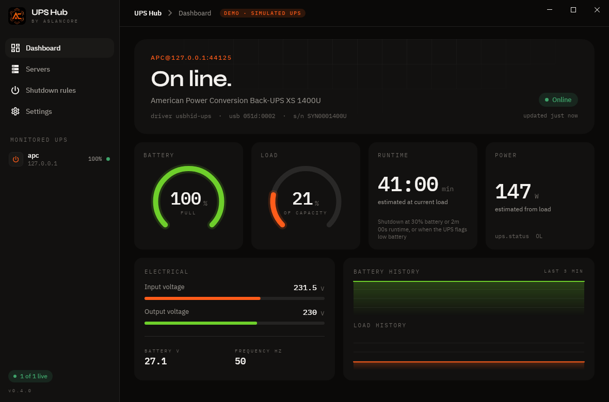

# UPS Hub

A Windows client for [Network UPS Tools](https://networkupstools.org/) (NUT). It watches your UPS and shuts the PC down cleanly before the battery runs out.

[](LICENSE) [](https://github.com/cyberwill01/UPS-Hub/releases/latest)

Built it from scratch in C# (.NET 10 + Avalonia). 



## What it does

- Monitors one or more NUT servers, and every UPS on them
- Finds NUT servers on your network by itself
- Shuts down, hibernates or sleeps the PC on low battery or low runtime, after a countdown you can cancel
- Sits in the tray with a status icon, and sends Windows notifications on power events
- Imports your old WinNUT-Client settings
- Reads a UPS plugged straight into the PC over USB (experimental, see below)
- Updates itself from GitHub Releases, checking the signature first

## Install

Grab the latest build from [Releases](https://github.com/cyberwill01/UPS-Hub/releases). There's an installer (`UpsHub-Setup-x.y.z.exe`, per-user, no admin needed) or a portable zip. You need Windows 10 or 11, 64-bit.

The builds aren't code-signed yet, so SmartScreen will probably warn you. Click "More info" and then "Run anyway". If you want to check the file first, compare its hash with `SHA256SUMS.txt` from the release:

```powershell
Get-FileHash .\UpsHub-Setup-0.4.0.exe -Algorithm SHA256
```

`SHA256SUMS.txt` is also signed with [minisign](https://jedisct1.github.io/minisign/). The key and the commands are in [docs/DETAILS.md](docs/DETAILS.md#updates-and-release-signing).

On first start, a short setup wizard helps you connect to your NUT server. If you don't have one yet, the server-side config is in [docs/DETAILS.md](docs/DETAILS.md#setting-up-the-nut-server).

## Direct USB is experimental

Reading a UPS directly over USB, without NUT, is a port of NUT's `usbhid-ups` driver. So far I've only tested it against my own APC BX1200MI.  If you try it, please [open an issue](https://github.com/cyberwill01/UPS-Hub/issues) with your UPS model and whether it worked. Going through a NUT server is the tested path.

## Building

You need the .NET 10 SDK.

```
dotnet test
dotnet publish src/UpsHub.App -f net10.0-windows10.0.19041.0 -p:PublishProfile=win-x64
```

That gives you a single self-contained `artifacts/win-x64/UpsHub.exe`. `dotnet run --project src/UpsHub.App -f net10.0 -- --demo` runs a demo with a simulated UPS, on Windows or Linux. More (installer, command line options, layout) is in [docs/DETAILS.md](docs/DETAILS.md).

## Credits

- [WinNUT-Client](https://github.com/gawindx/WinNUT-Client) by Gawindx, and the original WinNUT by Michael Liberman.
- [nutdotnet/WinNUT-Client](https://github.com/nutdotnet/WinNUT-Client), the maintained continuation, and its contributors.
- [Network UPS Tools](https://github.com/networkupstools/nut). The USB support uses NUT's `usbhid-ups` mapping tables and HID parser.

Full attributions, including fonts, are in [NOTICE.md](NOTICE.md).

## License

GPL-3.0-or-later, same as WinNUT-Client. See [LICENSE](LICENSE).
